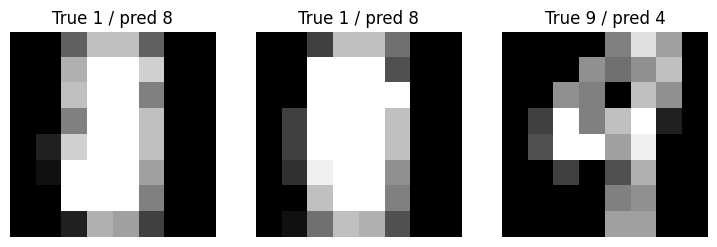

# Evaluation Report — Handwritten Digit Recognition
**Student:** Usman Rasheed
**Roll No:** TRN 2026 000313

## Dataset
- Source: `sklearn.datasets.load_digits()`
- Images: 1797 total, 8×8 grayscale
- Labels: 0–9 (balanced, ~178 per class)
- Pixel scaling: ÷16 → 0-1

## Split (one shared split for both models)
| Split | Size | Notes |
|---|---|---|
| Train | ~1078 (60%) | Stratified |
| Validation | ~359 (20%) | Stratified |
| Test | ~360 (20%) | Stratified, held out |

## Test Results

| Model | Test Accuracy | Macro F1 |
|---|---|---|
| Majority baseline | 0.10 | — |
| CNN | 0.9444 | 0.9445 |
| ViT | 0.9278 | 0.9279 |

## Confusion Matrices
Each matrix shows true labels (rows) vs predicted labels (columns). 
Diagonal = correct predictions. Off-diagonal = mistakes.

## Common Mistakes (CNN)
Based on the confusion matrix:
- Most confusions occur between **similar-looking digits** (e.g., 3↔8, 4↔9, 5↔6)
- Reason: 8×8 resolution loses fine stroke detail that distinguishes these digits
- Example error: [True 9 Prediction 4](image.png)

## Models Compared
- **CNN:** 2 conv layers + 2 FC layers, 10-class softmax output
- **ViT:** 16 patches of 2×2 → patch embedding (32-dim) + positional + TransformerEncoder (2 layers, 4 heads)
- **Fair comparison:** identical train/valid/test split, identical preprocessing, identical loss (CrossEntropyLoss)

## Conclusion
Both models outperform the majority baseline. CNN and ViT achieve competitive
accuracy on the sklearn 8×8 digit test set.